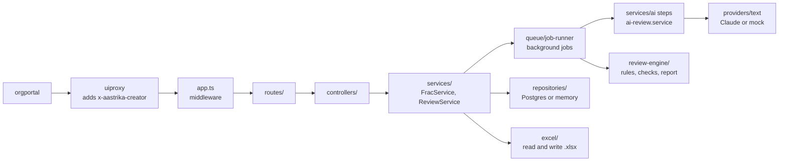

# frac-studio-service: codebase guide

What every folder and file does, how a request and a job move through them, and where each setting
lives. Read this with [ARCHITECTURE.md](ARCHITECTURE.md) (design decisions) and the
[spec](spec/FRAC_Creator_and_Reviewer_spec.md) / [review rules r3](spec/FRAC_Reviewer_rules_r3.md) (what
the product must do). Every source file also opens with a header comment saying the same in brief.

Last checked against the code: 5 November 2026.

For where the code starts and how each flow runs, see [CODE_FLOW.md](CODE_FLOW.md). For what each step does for the user, running modes, providers and pricing, see [FRAC_STUDIO_GUIDE.md](FRAC_STUDIO_GUIDE.md).

## 1. What the service does

FRAC Studio builds and reviews FRAC competency dictionaries (Functions, Roles, Activities, Competencies)
for Indian frontline health cadres. This service is its backend:

- **Creator** (spec §5): a FRAC is built in six steps. Steps 2–5 call an AI model as background jobs;
  step 6 runs the review engine on the FRAC and exports Excel.
- **Reviewer** (spec §6, rules r3): an uploaded Excel FRAC is parsed, checked by rules in code, checked by
  a fixed AI checklist, and graded by a verdict computed in code.
- **My FRACs**: lists, versions, restore, downloads.

The portal (orgportal) calls `/apis/protected/v8/fracStudio/*`; the uiproxy adds the signed-in user as the
`x-aastrika-creator` header and forwards to this service's `/v1/*`. The service never trusts an owner id
from the request body.

## 2. Top-level layout

| Path | What it is |
|---|---|
| `src/` | The running service, and only that (TypeScript, ESM, imports name the `.ts` file); compiled to `dist/` |
| `tools/` | Not the service: `reports/` (report builders and `npm run ai:report` / `review:report`), `ops/` (`config:check`, `ai:check`), `fixtures/` (`fixtures:sample`). Never imported by `src/`, not shipped |
| `test/` | API and data-path tests (`api`, `pg` on pg-mem, `sample`, `acceptance`) and shared builders in `test/support/` |
| `config/` | Runtime config, committed: `service.json` (every tunable), `ai-providers.json`, `frac-sizes.json`, `review-rules.json`, `outdated.json`, `method.txt` |
| `migrations/` | Numbered SQL files, applied once each by `npm run migrate` or `MIGRATE_ON_START=true` |
| `docs/` | All documentation: `CODE_FLOW.md`, this guide, the FRAC Studio guide, architecture, onboarding, `spec/`, and `releases/` (template, tracker, release notes) |
| `reports/` | Report files generated by `tools/reports/` |
| `Dockerfile`, `Dockerfile.build`, `build.sh`, `Jenkinsfile` | Build pipeline: compile and zip, build the runtime image, Sonar |
| `.github/workflows/build.yml` | CI: typecheck, lint, config check, build, tests with coverage, Sonar |
| `jest.config.js`, `eslint.config.js`, `tsconfig.json`, `tsconfig.tools.json` | Test, lint and compiler config. `tsconfig.json` builds `src/` into `dist/`; `tsconfig.tools.json` type-checks `src/` and `tools/` together without emitting. Lint and tests cover `src/` and `tools/` |

## 3. `src/` file by file

### Entry points

| File | Purpose |
|---|---|
| `server.ts` | Process entry. Picks the store (Postgres or memory) and the AI provider (`AI_PROVIDER`: a profile in `config/ai-providers.json`, or mock), wires repositories → JobRunner → ReviewService / FracService → app, checks the database, optionally migrates, starts the job watchdog, listens, optionally seeds mock data, and drains jobs on SIGTERM. |
| `app.ts` | Builds the Express app: request id, access log, helmet, CORS, JSON body, `/health` (no auth), `/v1` behind `requireOwner`, then the error handler. Does not listen, so tests use it directly. |
| `migrate.ts` | `npm run migrate` / `node migrate.js` in the image: applies pending migrations and exits (1 on failure). |
| `tools/ops/check-config.ts` | `npm run config:check`: rejects bad JSON, secrets, unknown keys and non-numbers in `config/service*.json`, checks `AI_PROVIDER` and `MOCK_PRICED_AS` name a profile, then prints the resolved settings. |
| `tools/reports/run-ai-report.ts` | `npm run ai:report`: reads `ai_calls`, jobs and reviews from Postgres for a period and writes the AI response report to `reports/`. |
| `tools/ops/ai-check.ts` | `npm run ai:check`: one tiny real call per tier to the `AI_PROVIDER` profile, printing model, tokens and cost. |

### `config/` (code that reads configuration)

| File | Purpose | Reads |
|---|---|---|
| `settings.ts` | Merges `config/service.json` and `service.<NODE_ENV>.json` into `process.env` without overriding values already set; refuses secrets (any `*_API_KEY`) and bad names. | `config/service*.json` |
| `constants.ts` | Every tunable as a frozen group (`SERVER`, `MODELS`, `RATES`, `LLM`, `LIMITS`, `JOBS`, `DB`, `CORS`, `LOG`, `PATHS`, `AI`, `REVIEW`, `MOCK`) plus `KNOWN_SETTINGS`. Importing it loads the settings. The only place that reads `process.env`, apart from `db.ts`. | `process.env` |
| `db.ts` | The Postgres pool and the `host:port/db` string used in messages. | `POSTGRES_*` (env only), `DB` pool sizing |
| `frac-sizes.ts` | Loads and validates the per-size targets; stops startup on a bad entry. | `config/frac-sizes.json` |
| `ai-providers.ts` | Loads and validates the provider profiles with Zod (kind, key variable, models, thinking, prices, web search, optional free-tier flag and concurrency cap); stops startup naming the profile and field at fault. | `config/ai-providers.json` |
| `review-rules.ts` | Loads the r3 rule tables plus the OUTDATED list. Called on every review, so rule edits apply without a restart. | `config/review-rules.json`, `config/outdated.json` |
| `outdated.ts` | Loads the OUTDATED list (superseded laws, programmes, terms). | `config/outdated.json` |
| `method.ts` | Loads the method paragraph for the Excel "Method & Sources" sheet; empty when the file is missing (it does not exist yet). | `config/method.txt` |

### HTTP layer

| Folder / file | Purpose |
|---|---|
| `middleware/requestContext.ts` | Request id (reuses a safe incoming `x-request-id`), echoed back and kept in AsyncLocalStorage for the logs. |
| `middleware/requestLogger.ts` | One access-log line per request with the error code; skips `/health`. |
| `middleware/auth.ts` | `requireOwner`: the owner comes from `x-aastrika-creator`; missing → 401 `NOT_SIGNED_IN`. `ownerOf(req)` for controllers. |
| `middleware/validate.ts` | Zod parsing; `validateBody` replaces `req.body` and drops undeclared fields; failure → 400 `VALIDATION_FAILED`. |
| `middleware/upload.ts` | Multer, in memory, one file, capped at `MAX_UPLOAD_MB`. |
| `middleware/errorHandler.ts` | The single error body `{ error: { code, message, details? } }`. Maps `ApiError`, workbook parse errors, upload and JSON errors; anything else is a logged 500. |
| `routes/index.ts` | The `/v1` router: `/fracs`, `/frac-reviews`, `/jobs/:id`, `/info` (which AI provider is on). |
| `routes/frac.routes.ts` | `/v1/fracs` wiring and validation. `/steps/check` is registered before `/steps/:step`. |
| `routes/review.routes.ts` | `/v1/frac-reviews` wiring: upload, then validation. |
| `controllers/frac.controller.ts` | Creator handlers. Steps and the check answer 202 `{ jobId }`; `GET /fracs/:id` also returns `activeJobId`. |
| `controllers/review.controller.ts` | Reviewer handlers. Upload answers 200 with the saved review when the fingerprint matches, else 202 with a job. |
| `controllers/job.controller.ts` | `GET /v1/jobs/:id`: status, message, x of y, error code, usage (calls, tokens, cost). Another owner's job is 404. |
| `controllers/http.ts` | Excel download helper and the route-param helper. |
| `health/health.controller.ts` | `GET /health` liveness; does not touch the database. |
| `validations/frac.schema.ts` | Zod shapes for create, patch, step and version id, with the `LIMITS` caps. Exports `FRAC_SIZES` and `NATIONAL_BASELINE`. |
| `validations/review.schema.ts` | Upload form fields: cadre, state, notes, `fresh`. |

### Domain types: `models/`

| File | Holds |
|---|---|
| `frac.model.ts` | The FRAC document (spec 4.1): roles, activities, competencies, levels, postings, research (sources with an optional `url`), versions, and `reviewStale` (the content changed after the expert check). Since Nov 2026: `sizeBy`/`sizeReason` (the agent chose the size), `seededFrom` (position matching) and `uploads` (standard sheets in use). |
| `document.model.ts` | A document attached to a FRAC: a brief document's text, or a standard sheet's import summary. |
| `review.model.ts` | `ReviewModel` (spec 4.2), the review engine's input, and `ReviewRecord`, a stored review. |
| `report.model.ts` | `Report`, `Finding`, `Stats`, severities (B, M, m), triage. |
| `job.model.ts` | A job row and the patch type. |

### Data: `repositories/` and `db/`

Every repository has a Postgres class and a memory class with the same interface (`FRAC_STUDIO_STORE=memory`
runs without a database).

| File | Owns |
|---|---|
| `repositories/frac.repository.ts` | `fracs` and `frac_versions` (the FRAC is a JSONB document); `findByCadre` for position matching. |
| `repositories/document.repository.ts` | `frac_documents` (migration 010): insert, list for a FRAC, delete. |
| `repositories/review.repository.ts` | `reviews`, including `findByFingerprint` for "same file, same review". |
| `repositories/job.repository.ts` | `jobs`: insert, patch update (column allowlist), get, `activeFor` (the live job on a FRAC or review), `failStale` for the watchdog. |
| `repositories/index.ts` | Builds the Postgres or memory bundle. |
| `repositories/row-helpers.ts` | `clone`, `byNewest`, `iso`. |
| `db/migrate.ts` | Runs each pending migration once, in its own transaction, under an advisory lock, recorded in `schema_migrations`. |
| `db/check.ts` | `SELECT 1` at startup, so a missing database stops the service with a clear message. |

| Migration | Change |
|---|---|
| `001_init.sql` | `fracs`, `frac_versions`, `reviews`, `jobs` and their indexes |
| `002_job_error_code.sql` | `jobs.error_code` and a `(status, updated_at)` index for the watchdog |
| `003_review_fingerprint.sql` | `reviews.fingerprint` and an `(owner_id, fingerprint)` index |
| `004_ai_calls.sql`, `005_…`, `006_…` | `ai_calls`, one row per model call, with its start time and thinking tokens |
| `007_server_runs.sql` | `server_runs`, one row per server start and stop |
| `008_review_answer_cache.sql` | `review_answer_cache`, stored checklist answers for repeat checks |
| `009_one_active_job.sql` | At most one queued or running job per FRAC or review |
| `010_frac_documents.sql` | `frac_documents`: brief documents and standard sheet imports per FRAC |

### Creator: `services/frac.service.ts` and `services/ai/`

`FracService` creates, reads, edits, versions, restores and exports FRACs, and starts steps as jobs. Before a
job starts it checks the step's prerequisite (409 `STEP_NOT_READY`). When a step finishes it merges the result
into the **latest** saved FRAC (so edits made meanwhile are kept), raises `step`, appends to the log and saves
a version.

| File | Purpose |
|---|---|
| `ai/step-context.ts` | The step contract and `callModel`: call the provider → record usage and cost → validate the JSON with Zod (`AI_OUTPUT_INVALID` on a bad shape, after the spend is recorded). |
| `ai/prompts.ts` | Every prompt, with the personas Kaushal (FRAC architect) and Vidya (clinical and programme accuracy). |
| `ai/schemas.ts` | The Zod output shape of every AI call. |
| `ai/sizes.ts` | `SIZE_TARGETS` from `config/frac-sizes.json` and `BATCH` from `AI_BATCH_SIZE` / `AI_BATCH_PARALLEL`. |
| `ai/batching.ts` | `runInBatches`: N items per call, M calls at once, results in the original order. |
| `ai/research.step.ts` | Step 2: one call; code prefix cleaned, at most 3 postings (P1–P3), `VERIFY:` items added to assumptions. Reads attached documents (fewer searches), keeps a Sources sheet's rows and fixed postings, checks each source link (`source-links.ts` `linkSources`), applies an agent-chosen size. |
| `ai/source-links.ts` | Research source links: keeps a link only when it is a searched page or an address on the research domains or `SOURCE_LINK_DOMAINS` that answers a quick check (`SOURCE_LINK_CHECK_TIMEOUT_MS`, at most `SOURCE_LINK_MAX_CHECKS` per run); a source with no link is matched to a searched page by title; never reaches internal addresses (`webLink`). |
| `ai/roles.step.ts` | Step 3: one roles call, then activities in batches; global R/A numbering; team-added activities kept; competencies kept and flagged "roles changed". Roles from a sheet or a match: `fillGaps` writes activities only for empty roles. |
| `ai/competencies.step.ts` | Step 4: one call; writes `competency@level` on each activity; keeps a ladder only when code and label are unchanged. With a Competencies sheet: `mapToSheet`, one `mapping` call to the fixed codes. |
| `ai/ladders.step.ts` | Step 5: batches of competencies, saved after each batch; `codes` limits it to "Revise {code}" / "Fix these competencies" / "Rewrite all". |

| Step | Tier | Calls |
|---|---|---|
| Research | complex (high effort) | 1, plus up to `RESEARCH_SEARCH_MAX_USES` government-site web searches |
| Roles and activities | complex, then default (medium) | 1 + roles ÷ `AI_BATCH_SIZE` |
| Competencies | complex | 1 |
| Level ladders | default | competencies ÷ `AI_BATCH_SIZE` |
| Expert check | complex | laddered competencies ÷ `REVIEW_BATCH_SIZE`, + 1 state call |

Each provider profile in `config/ai-providers.json` sets the model and thinking level per tier.

### Documents: `services/document.service.ts` and `services/documents/`

Review decisions of Nov 2026 (`docs/releases/REVIEW_DECISIONS_2026-11.md`).

| File | Purpose |
|---|---|
| `document.service.ts` | Upload, list and remove documents on a FRAC; applies a sheet import to the FRAC (version first; refused while a step runs); serves the templates. |
| `documents/extract-text.ts` | PDF (unpdf), DOCX (mammoth) and TXT to text, capped at `DOC_MAX_CHARS`. |
| `documents/sheet-formats.ts` | The Roles, Competencies and Sources layouts, shared by the importer and the templates, plus the brief guide. |
| `documents/import-sheets.ts` | Reads those sheets, reusing the Reviewer's header helpers and `parseCompetencies`. |
| `excel/csv-reader.ts` | CSV upload to the same sheet shape as a workbook. |

### Reviewer: `services/review.service.ts`, `services/ai-review.service.ts`, `services/review-engine/`

`ReviewService` runs the whole flow: read the workbook → parse → fingerprint → reuse a saved review or start a
job → rule-based checks → AI checklist → report → store. It also handles rerun, the Creator's expert-check
record, list, export and "Open in Creator".

| File | Purpose |
|---|---|
| `review-engine/parse-workbook.ts` | Sheets → `ReviewModel`: finds header rows, every competency sheet (laddered and KCM format), the Role–Activity sheet (two layouts), a `Position:` cell. |
| `review-engine/refs.ts` | Parses mapping cells ("C1-C4 @L3", bare numbers, ranges) and formats them back. |
| `review-engine/rules.ts` | Types of the config rule tables, the cadre family (ASHA, ANM, CHO, nurse), and the fixed patterns that define the method (BANNED verbs, SYLLABUS, …). |
| `review-engine/checks.ts` | Every rule-based check (section 5 below). Pure: no I/O. |
| `ai-review.service.ts` | Vidya's checklist: Q1 scope and Q2 accuracy per competency in batches, Q3 state fit once; quote verification; duplicates of rule-based findings dropped; at most 3 fixed-title findings. |
| `review-engine/report.ts` | Sort, per-check status, triage, verdict, summary, strengths: all computed, never written by the AI. |
| `review-engine/fingerprint.ts` | `ENGINE_VERSION` ("r3") + hash of the rule tables + parsed model + context → the "same file, same review" key. |
| `review-engine/convert.ts` | FRAC ↔ `ReviewModel`, and the model as prompt text for the state call. |

### Jobs: `services/queue/` and the watchdog

| File | Purpose |
|---|---|
| `queue/job-runner.ts` | Runs a task in-process and records status, progress and usage on its `jobs` row. Writes are chained so parallel batches never overwrite a newer total; a heartbeat (`JOB_HEARTBEAT_MS`) keeps a job fresh during a long model call; one "Job spend" log line per job. `startExclusive` allows one live job per target (409 `JOB_RUNNING`; a job silent for two heartbeats is replaced), and a job stops with `AI_BUDGET_EXCEEDED` at `JOB_MAX_COST_USD` of billed spend. |
| `queue/job-messages.ts` | The progress text shown in the portal, and the expert-check note. |
| `job-watchdog.service.ts` | Marks jobs left running by a restart as `JOB_INTERRUPTED` after `JOB_STALE_AFTER_MS`. |

### AI providers: `providers/` and `mocks/`

| File | Purpose |
|---|---|
| `providers/text/types.ts` | The `TextProvider` seam: task, tier, prompt in; JSON, usage and cost out. |
| `providers/text/claude.ts` | Claude (profile kind `claude`): streaming, the profile's thinking level as `effort`, web search for research, `pause_turn` resume, refusals and truncation mapped to coded errors. |
| `services/ai/ask-model.ts` | `askModel`: the one call path for Creator steps and the review checklist. Times the call, validates the answer, and reports it once (tokens, cost, outcome) so the job total and `ai_calls` both see it. |
| `tools/reports/review-report.ts` | Builds the review analysis report for one upload or one FRAC's expert checks. Pure. |
| `tools/reports/run-review-report.ts` | `npm run review:report -- <id>`: loads a review or a FRAC's expert checks and their calls, writes `reports/reviews/review-<id>.md`. |
| `tools/reports/ai-report.ts` | Builds the AI response report (Markdown) from calls, jobs and reviews. Pure. |
| `repositories/review-answer-cache.repository.ts` | Stored AI checklist answers by fingerprint, so a repeat check skips unchanged competencies. |
| `repositories/server-run.repository.ts` | Server starts and stops, for the per-run report. |
| `repositories/ai-call.repository.ts` | The `ai_calls` per-call log: Postgres and memory. Insert-only. |
| `providers/text/json.ts` | `extractJson`: the one JSON object in a model's final text; shared by every provider. |
| `providers/text/limit.ts` | `limitConcurrency`: caps calls in flight for a profile's `maxConcurrent` (none of the current profiles set one). |
| `providers/text/pricing.ts` | USD per call from tokens, cache reads and writes, and web searches, at the given profile's `rates`. |
| `providers/registry.ts` | Builds the provider `AI_PROVIDER` names: `mock` loads `src/mocks` dynamically; anything else is a profile whose `kind` picks a factory and whose `keyEnv` names the key. Stops startup with what to set otherwise. |
| `mocks/mock-text-provider.ts` | Answers every task with sample data in the real shapes; estimates tokens and prices them at the `MOCK_PRICED_AS` profile's rates, marked `estimated`. |
| `mocks/content/cadres.json` | The sample roles, activities and competencies per cadre. Demo data, not clinical guidance. |
| `mocks/seed.ts`, `mocks/index.ts` | One finished FRAC and review per owner at startup (`MOCK_SEED`, memory store); the folder's entry point. |

### Excel: `services/excel/`

| File | Purpose |
|---|---|
| `workbook-reader.ts` | Upload → sheets of plain text; falls back to the streaming reader for files the full loader refuses. |
| `workbook-writer.ts` | The Creator export (FRAC, Competencies, Method & Sources with a URL column, Expert check), the Reviewer export (Review) and `buildTemplateWorkbook` for the upload templates. "Found by" says only "Rule-based check" or "AI judgement (quoted)". |

### Shared: `utils/`

| File | Purpose |
|---|---|
| `response.ts` | `ApiError` and its shorthands (`badRequest`, `conflict`, `notFound`, …). |
| `logger.ts` | Structured logger (json or pretty) with the request id; `describeError`. |
| `context.ts` | AsyncLocalStorage for the request id. |
| `codes.ts` | `sanitizeCodePrefix`: A–Z only, at most 4 letters, fallback "C". |

## 4. How a request and a job flow

**A Creator step** (`POST /v1/fracs/:id/steps/ladders`):

1. `requestContext` → `requestLogger` → `requireOwner` → `validateBody(stepSchema)`.
2. `frac.controller` → `FracService.startStep`: loads the FRAC (404 if another owner's), checks the
   prerequisite (409 `STEP_NOT_READY`), and asks `JobRunner.startExclusive` to start a job (409 `JOB_RUNNING` if one
   is already live on this FRAC; migration 009's unique index covers two starts at once). Answers 202 `{ jobId }` at once.
3. In the background: `runLadders` → `runInBatches` → `callModel` → provider. Each call records usage; each
   batch saves into the latest FRAC and reports "x of y"; a ladders batch also marks an earlier expert check out
   of date (`reviewStale`). The job stops if its billed spend reaches `JOB_MAX_COST_USD`.
4. On finish: merge, raise `step`, log, snapshot a version, mark the job done, log "Job spend".
5. The portal polls `GET /v1/jobs/:id` until done, then reloads the FRAC.

**A Reviewer upload** (`POST /v1/frac-reviews`):

1. Multer reads the file; `validateBody(reviewContextSchema)`.
2. `ReviewService.startUploadReview`: read the workbook, parse it (400 `NO_COMPETENCY_SHEET` if none),
   fingerprint it. A saved review with the same fingerprint → 200 with that review id and no job.
3. Otherwise a job: `computeChecks` → `ChecklistReviewer.review` → `buildReport` → store with the fingerprint.

## 5. Rule-based checks (`review-engine/checks.ts`)

Severity: B blocker, M major, m minor.

| Finding | Sev | When | Rules |
|---|---|---|---|
| Level labels use non-measurable verbs | M if the worst level has ≥ 25% of laddered competencies, else m | A level label starts with a BANNED verb | §4.1 |
| Some indicators use non-measurable verbs | m | Only when no label hit: an indicator starts with a BANNED verb | §4.1 |
| No Role–Activity sheet | M | No FRAC sheet was found | §4.2 |
| Activities read as syllabus outcomes | M if ≥ 30%, else m | An activity starts with a SYLLABUS verb; triage becomes rebuild | §4.2, §7 |
| Roles with fewer than 2 activities | m | A role has under 2 activities | §4.2 |
| Competency type is missing | M | No competency is typed; triage becomes rebuild | §4.2, §7 |
| No Behavioural / No Functional competencies | M | Some types exist but B and/or F is absent | §4.2 |
| Competencies are too broadly defined | M (m if only part e) | Catch-all label, spans ≥ 3 clinical areas, scheme list, above the post (frontline), topic definition | §4.2.1 |
| Domain competencies that match KCM names | m | A Domain label matches a KCM Functional or Behavioural name | §4.2 |
| KCM competencies this post does not demand | m | Frontline only: a KCM competency the post does not need | §4.2 |
| Incomplete level ladders | M if > 10%, else m | Fewer than 5 level labels; more than half incomplete → rebuild | §4.3, §7 |
| Functional and Behavioural competencies have no job ladder | M | KCM-format rows | §4.3 |
| Generic L5 label repeated across competencies | M each | The same L5 label on ≥ 3 competencies | §4.3 |
| Same label at two levels | m | One competency repeats a label across its levels | §4.3 |
| Level ladders are shifted upward | M | A `ladder` rule in config matches its levels | §4.3 |
| Beyond {cadre} scope: {act} | from the rule | A `scope` rule for the cadre matches a sentence and `allow` does not | §4.4 |
| Outdated reference: {term} | from the pattern | An `outdated.json` pattern matches, subject to `frontlineOnly`, `onlyIfAbsent`, `unlessNear` | §4.5 |
| Activities are not mapped to competencies yet | m | No mapping column (the next three are then skipped) | §4.6 |
| Activities not mapped to a competency | M if ≥ 5%, else m | An activity has no reference | §4.6 |
| Competencies never used | m | Nothing references it | §4.6 |
| Mappings point to undefined competencies | M | A reference names a code no sheet defines | §4.6 |
| Activities with no posting marked | m | Some activities have every posting blank | §4.6 |
| Core {cadre} areas with no dedicated competency | M | An `areas` entry for the cadre matches no competency | §4.6, §5 |

The AI adds at most three: "Other acts beyond {cadre} scope" (B), "Clinical or programme facts to correct"
(M), "Does not reflect {state}" (m). An AI flag is dropped when its quote is not in that competency, is
under `REVIEW_MIN_QUOTE_WORDS` words, matches an OUTDATED pattern or a ladder rule marked
`suppressesAiFlags` that applies to the cadre, or repeats a rule-based scope hit at the same level.

Triage: **rebuild** when activities read as syllabus outcomes, no competency is typed, or more than half the
ladders are incomplete; **revise** on any Blocker or 3+ Majors; otherwise **use**.

## 6. What is configurable, and what is not

| To change | Edit | Takes effect |
|---|---|---|
| Provider choice, call limits, batching, research search and source-link domains (`SOURCE_LINK_DOMAINS`), request limits, jobs (incl. the `JOB_MAX_COST_USD` spending limit), Postgres pool | `config/service.json` (an env var of the same name wins) | Restart |
| Models, thinking levels, prices, key variable, web search per provider | `config/ai-providers.json` | Restart |
| Roles, activities and competencies per brief size | `config/frac-sizes.json` | Restart |
| Scope rules, ladder-shift rules, core areas | `config/review-rules.json` | Next review |
| Outdated laws, programmes and terms | `config/outdated.json` | Next review |
| API key, Postgres connection | `.env` locally, the secret store on a server | Restart |

The full key list with defaults is in the [README](../README.md#tuning-without-a-code-change).
`npm run config:check` fails on unknown keys, secrets and non-numbers. Editing either rule file changes the
review fingerprint, so a review made under old rules is never reused.

**Kept in code on purpose**, because the spec fixes them and changing them changes the product: at most 3
postings, 5 levels per ladder, the finding titles, severity and triage thresholds, the BANNED / SYLLABUS
patterns, the five state categories, `ENGINE_VERSION`, and the Excel layout.

## 7. Tests

| Where | Covers |
|---|---|
| `src/**/*.test.ts` | Unit tests next to the code: settings, sizes, migrations, pricing, every review check and r3 rule, the checklist reviewer, report, refs, parser, Excel, job runner and watchdog |
| `src/mocks/review-decisions.test.ts` | Agent-chosen size, brief documents, each standard sheet, templates, uploads while a step runs, position matching; asserts which AI calls each case makes |
| `src/mocks/mock-flow.test.ts` | The whole Creator flow on the mock, the expert check, "same file, same review", rerun, and the check going out of date after a fix or edit |
| `test/api.test.ts` | Every route through HTTP on the memory store, including one live job per FRAC and replacing a silent job |
| `test/pg.test.ts` | The real migrations and the API on pg-mem (in-memory Postgres) |
| `test/sample.test.ts` | Three synthetic workbooks with defects planted at known counts |
| `test/acceptance.test.ts` | Spec §6.6 on the real dictionaries; skipped until they are in `test/fixtures/` |

`npm run check` = typecheck + lint + config check + tests. Tests never call a real model.

## 8. Known gaps and notes

- **Prompts:** the METHOD and SOURCE_LIBRARY text in `ai/prompts.ts` are stand-ins until the verbatim text
  from the prototype arrives.
- **Position matching** covers only the owner's FRACs (FRACs carry no organisation yet), then the portal checks
  the Positions master. A sheet is used as it is; its quality becomes the FRAC's.
- **Batching:** when one batch fails, batches already running finish (their spend is recorded); there is no
  cancellation.
- **"Fix these competencies"** always rewrites ladders, so it cannot clear a finding about a label (too broad, KCM
  name) or about the whole FRAC (state fit). Proposed: a `fixWith` per finding that routes it to the step that can fix it.
- **Prompt caching** is not used: batches start together, so every call would miss and pay the cache-write price.
- **Spending limit** is per job only; there is no daily limit yet (the daily report warns at `REPORT_DAILY_BUDGET_USD`).
- **Usage totals:** `jobs.usage` counts input tokens including cache tokens; the cost already prices them at
  their own rates.
- **Mock:** generic activities for unknown roles are labelled "Added by team", so a mock revise keeps them as
  team edits.
- **`convert.ts` `competencyRefs`** is used only by tests.
- **Rule flags:** `allow`, `onlyIfAbsent` and `unlessNear` patterns are always case-insensitive; there is no
  per-pattern flag for them yet.
- **Lint scope:** `test/` and the `*.config.js` files are not linted or type-checked; `tools/fixtures/` is transpile-only.
- **Research web search** is Claude's `web_search` tool, which enforces `RESEARCH_SEARCH_DOMAINS`. The prompt
  tells the agent to search for the JD and main guidelines before listing them; a run that searched 0 times
  still finishes, but its sources may have no links.
- **Prompts were written against Claude.** They ask for JSON in a fixed shape and every answer is validated;
  answer quality of `claude-mixed` and `claude-fast` should be compared on the acceptance fixtures before go-live.
