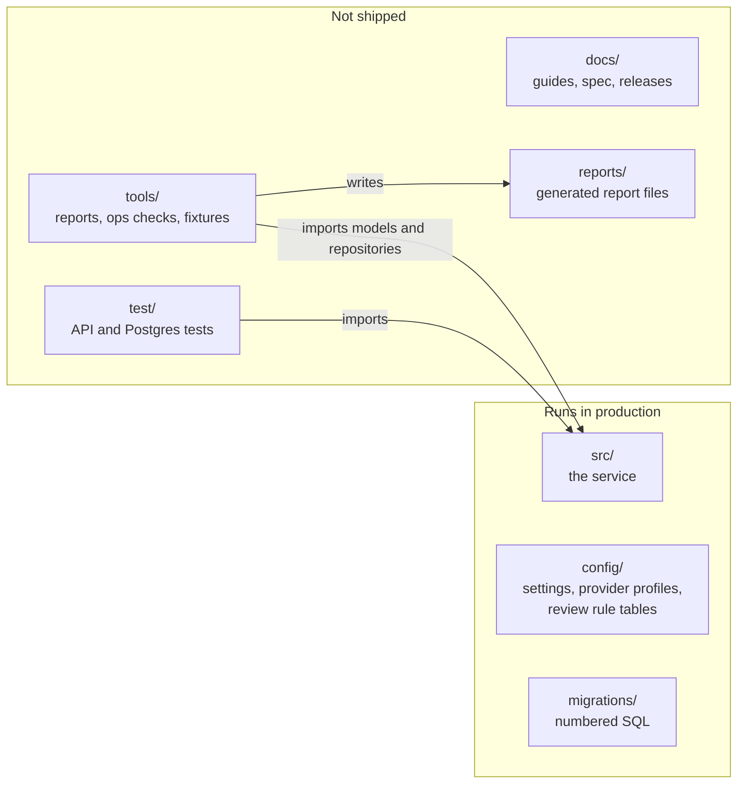
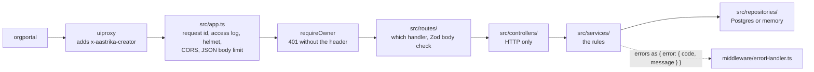
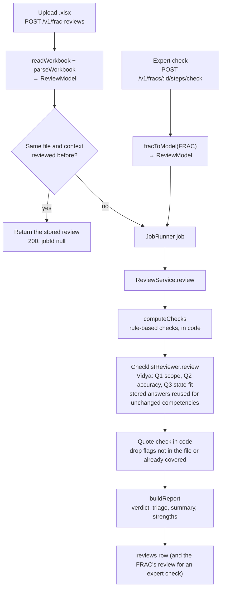
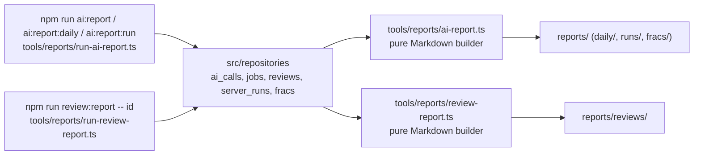

# Code flow: where the code starts and how each flow runs

Read this first. It follows the code from `npm run dev:ai` to a finished FRAC, a review and a report, with the
file and line where each hop happens. For what every file is, see [CODEBASE_GUIDE.md](CODEBASE_GUIDE.md); for
what the user sees at each step, see [FRAC_STUDIO_GUIDE.md](FRAC_STUDIO_GUIDE.md). Line numbers are as of
9 Nov 2026; if one has moved, search for the function name next to it.

## 1. What is where

Only `src/` runs in production. Everything else supports it.



| Folder | What it holds | Shipped in the image? |
| --- | --- | --- |
| `src/` | The service: HTTP API, AI steps, review engine, jobs, storage. `src/` never imports `tools/` | Yes, compiled to `dist/` |
| `config/` | `service.json` (settings), `ai-providers.json` (models and prices), `review-rules.json` and `outdated.json` (rule tables), `frac-sizes.json`, `method.txt` | Yes |
| `migrations/` | `001`–`010` numbered SQL, applied once each | Yes |
| `tools/reports/` | The report builders and their command-line entry points (`npm run ai:report`, `ai:report:daily`, `ai:report:run`, `review:report`) | No |
| `tools/ops/` | `npm run config:check` (CI) and `npm run ai:check` (one tiny real call) | No |
| `tools/fixtures/` | `npm run fixtures:sample` (sample workbooks for tests) | No |
| `test/` | API, Postgres-path and acceptance tests, and shared test data | No |
| `docs/` | This file, the guides, architecture, onboarding, the spec, and `releases/` (template, tracker, release notes) | No |
| `reports/` | Report files the tools write (daily, per run, per FRAC, per review) | No |

## 2. Where it starts

`npm run dev:ai` (or `npm start` on a server) runs **`src/server.ts`**. In order:

| # | What happens | Where |
| --- | --- | --- |
| 1 | `.env` is loaded, then `config/service.json` is merged into the environment (importing `config/constants.ts` does it) | `src/server.ts:1`, `src/config/settings.ts` |
| 2 | Postgres pool, or the in-memory store when `FRAC_STUDIO_STORE=memory` | `src/server.ts:27-28` |
| 3 | The job runner, which also writes each AI call to `ai_calls` | `src/server.ts:30` |
| 4 | The AI provider: `AI_PROVIDER` names a profile in `config/ai-providers.json` (or `mock`); `dev:ai` refuses the mock | `src/server.ts:34` → `src/providers/registry.ts:65` |
| 5 | The services: `ReviewService` (with Vidya's checklist and its answer store), `FracService` and `DocumentService` (attached documents and templates) | `src/server.ts:36-39` |
| 6 | Startup stops if Postgres is unreachable; migrations run when `MIGRATE_ON_START=true` | `src/server.ts:41-43` |
| 7 | The stuck-job watchdog starts | `src/server.ts:47` → `src/services/job-watchdog.service.ts:28` |
| 8 | A `server_runs` row records this run (for `npm run ai:report:run`) | `src/server.ts:50` |
| 9 | The HTTP app (`src/app.ts`) listens on `PORT`; the log prints `"ai":"<provider>"` and the run id | `src/server.ts` (`listen`) |
| 10 | Ctrl+C or SIGTERM: stop taking requests, let running jobs finish, close the run row, exit | `src/server.ts` (`shutdown`) |

## 3. How a request gets in

The portal never calls the service directly: orgportal → uiproxy (`/apis/protected/v8/fracStudio/*`, sets the
signed-in user as `x-aastrika-creator`) → this service at `/v1/*`.



| Layer | Files | Rule |
| --- | --- | --- |
| App and middleware | `src/app.ts:24-44`, `src/middleware/` | Order matters: request context first, error handler last |
| Routes | `src/routes/index.ts:26-37`, `frac.routes.ts:13-33`, `review.routes.ts:14-19` | Wiring and body validation only |
| Controllers | `src/controllers/` | Read params, call one service method, send the response |
| Services | `src/services/frac.service.ts`, `review.service.ts` | Business rules; long work becomes a job |
| Repositories | `src/repositories/` | All SQL; one file per table, each with a memory twin for tests |

## 4. Flow A: a Creator step (research, roles, competencies, ladders)

Example: the user clicks "Write level ladders".

```mermaid
sequenceDiagram
  participant UI as Portal
  participant C as frac.controller
  participant F as FracService
  participant J as JobRunner
  participant S as runLadders
  participant M as askModel
  participant P as Provider (Claude / mock)
  UI->>C: POST /v1/fracs/:id/steps/ladders
  C->>F: startStep(owner, id, "ladders", body)
  F->>F: STEPS["ladders"].notReady? → 409 STEP_NOT_READY
  F->>J: start(job) → jobs row "queued"
  J-->>UI: 202 { jobId }
  Note over J: runs in the background
  J->>S: task(progress, recordUsage) inside jobContext
  loop 8 batches of 4 competencies, 6 at once
    S->>M: callModel(prompt, laddersOutput)
    M->>P: complete(task, tier, prompt, schema)
    P-->>M: JSON + tokens + cost
    M->>J: recordUsage → jobs.usage + ai_calls row
    S->>F: save(batch) merged into the latest FRAC
  end
  J->>J: status "done"; version snapshot; log line "Job spend"
  UI->>C: GET /v1/jobs/:id (polls) → done → reload FRAC
```

| Hop | Where |
| --- | --- |
| Route and controller | `src/routes/frac.routes.ts:25` → `src/controllers/frac.controller.ts:54` |
| Step registry and readiness check | `src/services/frac.service.ts:170` (`STEPS`), `:207` (`startStep`) |
| Job created, 202 returned (409 `JOB_RUNNING` if one is live) | `src/services/frac.service.ts:213` → `src/services/queue/job-runner.ts:114` (`startExclusive`) → `:85` (`start`) |
| Background run, heartbeat, job context | `src/services/queue/job-runner.ts:136`, `:194` |
| The step logic | `src/services/ai/research.step.ts:96`, `roles.step.ts:82` (`fillGaps` `:61` for given roles), `competencies.step.ts:59` (`mapToSheet` `:44` for a Competencies sheet), `ladders.step.ts:29` |
| Prompts (personas, METHOD, the Reviewer's scope rules) | `src/services/ai/prompts.ts` (`reviewGuard`, `laddersPrompt`, …) |
| One model call: time it, validate, retry once, record | `src/services/ai/step-context.ts:37` → `src/services/ai/ask-model.ts:41` |
| The provider | `src/providers/text/claude.ts:86` (or `src/mocks/`); research's web-search pages come back as `citations` (`searchCitations`) |
| Spend per call and per job | `src/services/queue/job-runner.ts:181` (`ai_calls`), `jobs.usage`; the `JOB_MAX_COST_USD` limit in the same `recordUsage` |
| Saving with team edits kept, snapshot | `src/services/frac.service.ts:215-229` (research also loads the FRAC's documents here) |

Which persona each step uses: research, roles, activities and competencies are Kaushal; ladders are Kaushal
and Vidya in the same call (see the "agents" table in [FRAC_STUDIO_GUIDE.md](FRAC_STUDIO_GUIDE.md)).

### Documents, templates and position matching (Nov 2026)

| Flow | Where |
| --- | --- |
| Position match on the brief | `GET /v1/fracs/match`: `frac.routes.ts:20` → `frac.controller.ts:33` → `frac.service.ts:254` (`match`) → `FracRepository.findByCadre` |
| Create from a match (`seed`) | `frac.service.ts:237` (`create`) → `seedContent`, `positionRoles` |
| Attach a document or import a sheet | `frac.routes.ts:31` → `document.controller.ts` → `document.service.ts:109` (`upload`): `extractDocumentText`, or `import*Sheet` then `apply*Import`, version first |
| Remove a document | `frac.routes.ts:32` → `document.service.ts:158` |
| Template download | `routes/index.ts:30` → `DocumentService.template` (`document.service.ts:172`) → `buildTemplateWorkbook` |
| How steps use them | research reads `ctx.documents` (`research.step.ts:96`); roles `fillGaps`; competencies `mapToSheet`; ladders skip competencies whose ladder came in the sheet |

## 5. Flow B: the expert check, and Flow C: a Reviewer upload

Both run the same review engine. Only how the FRAC arrives differs.



| Hop | Where |
| --- | --- |
| Upload route, file limits | `src/routes/review.routes.ts:14` → `src/controllers/review.controller.ts:14` |
| Read and parse the workbook | `src/services/review.service.ts:123-132` → `src/services/excel/workbook-reader.ts`, `src/services/review-engine/parse-workbook.ts` |
| Same file, same review (fingerprint) | `src/services/review.service.ts:134` → `src/services/review-engine/fingerprint.ts` |
| Expert check entry | `src/routes/frac.routes.ts:24` → `src/services/frac.service.ts:298` (clears `reviewStale`) |
| The review itself | `src/services/review.service.ts:75` (`review`) |
| Rule-based checks | `src/services/review-engine/checks.ts` (`computeChecks`), tables in `config/review-rules.json`, `config/outdated.json` |
| Vidya's checklist, answer reuse | `src/services/ai-review.service.ts:112`, `:131` (stored answers), `:155` (store new ones) |
| Quote check | `src/services/ai-review.service.ts:190-201` (`locateQuote`) |
| Verdict and triage | `src/services/review-engine/report.ts:79` (`computeTriage`), `:139` (`buildReport`) |
| "Run a fresh review" | `src/routes/review.routes.ts:19` → `ReviewService.rerun` (asks everything again) |

## 6. Flow D: the Excel download

`GET /v1/fracs/:id/export.xlsx` → `src/services/frac.service.ts:335` → `buildFracWorkbook`
(`src/services/excel/workbook-writer.ts:113`) with the method paragraph from `config/method.txt`. A review's
download uses `buildReviewWorkbook` (`:212`). No AI call.

## 7. Background safety nets

| What | Where | Why |
| --- | --- | --- |
| Heartbeat | `src/services/queue/job-runner.ts` (`setInterval`) | A long model call keeps its job fresh |
| Watchdog | `src/services/job-watchdog.service.ts:19` | A job left running by a crash is failed as `JOB_INTERRUPTED` |
| One live job per target | `src/services/queue/job-runner.ts:114`, `migrations/009_one_active_job.sql` | A reload, second tab or double click cannot start a second paid job |
| Spending limit | `src/services/queue/job-runner.ts` (`recordUsage`), `JOB_MAX_COST_USD` | A runaway job stops at $3 of billed spend |
| Concurrency cap | `src/providers/text/limit.ts` | A profile's optional `maxConcurrent` (none of the current profiles set one) |
| Retries | the SDK (408/429/5xx); `askModel` retries a wrong-shape answer once | Transient errors and malformed answers |

## 8. The tools: reports and checks (not the running service)

The tools read what the service stored and write files; the service never calls them.



| Command | Entry | Writes |
| --- | --- | --- |
| `npm run ai:report` (`--days`, `--since`, `--from/--to`, `--frac <id>`, `--provider`) | `tools/reports/run-ai-report.ts` | `reports/ai-report-<date>.md`, `reports/fracs/` |
| `npm run ai:report:daily` (`--yesterday`, `--day`) | same, `--daily` | `reports/daily/` |
| `npm run ai:report:run` (`--run <id>`) | same, `--run` | `reports/runs/` |
| `npm run review:report -- <id>` | `tools/reports/run-review-report.ts` | `reports/reviews/` |
| `npm run config:check` (CI) | `tools/ops/check-config.ts` | stdout |
| `npm run ai:check` | `tools/ops/ai-check.ts` | stdout |

The data they read is written by the service: every model call in `src/services/ai/ask-model.ts` →
`job-runner.ts` → `ai_calls`; server starts and stops in `src/server.ts` → `server_runs`; review checklist
counts on each report (`report.aiChecklist`).

## 9. Where to change what

| To change | Edit | Code change? |
| --- | --- | --- |
| Which AI answers, models, prices | `config/ai-providers.json`, `AI_PROVIDER` | No |
| Batch sizes, limits, timeouts, report settings | `config/service.json` | No |
| Rule-based review checks, scope lists, outdated names | `config/review-rules.json`, `config/outdated.json` (also feed the Creator prompts) | No |
| FRAC size targets | `config/frac-sizes.json` | No |
| Prompt wording | `src/services/ai/prompts.ts` | Yes |
| A step's logic | `src/services/ai/<step>.step.ts` | Yes |
| A new AI provider | `src/providers/text/<kind>.ts`, `src/providers/registry.ts`, `src/config/ai-providers.ts`, a profile | Yes |
| A new report section | `tools/reports/ai-report.ts` or `review-report.ts` | Yes (tools only) |
| The database | a new `migrations/00N_name.sql`, never edit an applied one | Yes |
