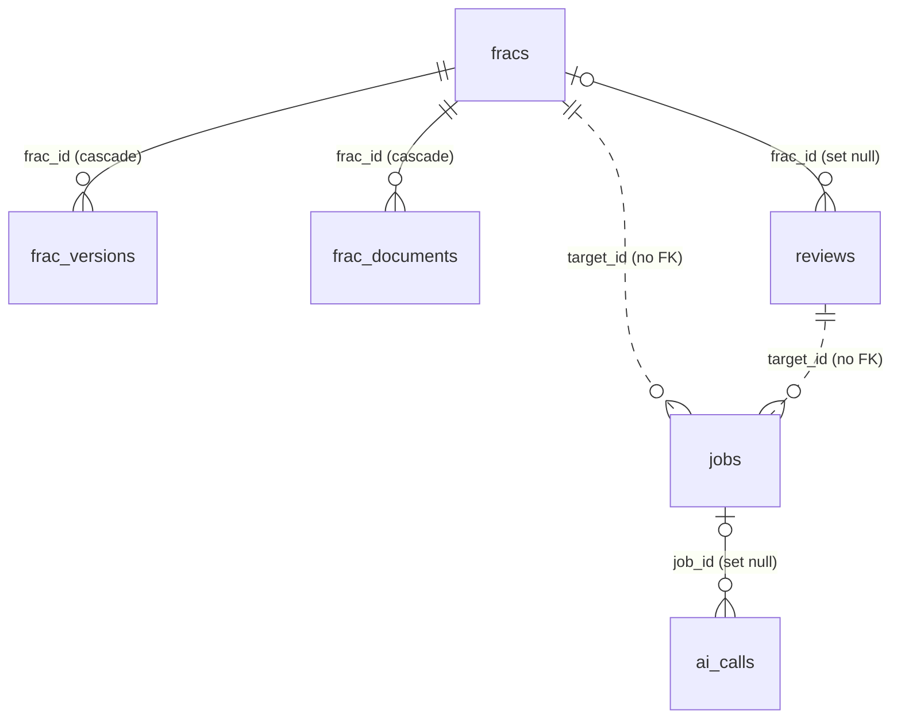

# Database schema

FRAC Studio stores everything in one PostgreSQL database: 9 tables, created by the 10 files in `migrations/`
(`001_init.sql` to `011_frac_dictionary_documents.sql`). Each FRAC is kept whole as one JSONB document; the other tables hold
history, uploads, reviews, background jobs and AI cost records. This file is the reference for every table, column,
constraint, index and JSONB shape. To open the database in pgAdmin, see [DATABASE.md](DATABASE.md).

The migrations are the source of truth. When you add one, update this file in the same change.

## Overview

| Item | Detail |
| --- | --- |
| Database | PostgreSQL, used only by this service |
| Connection | `POSTGRES_HOST`, `POSTGRES_PORT` (default 5432), `POSTGRES_DATABASE`, `POSTGRES_USER`, `POSTGRES_PASSWORD`; pool: `POSTGRES_POOL_MAX`, `POSTGRES_CONNECT_TIMEOUT_MS`, `POSTGRES_IDLE_TIMEOUT_MS` (`src/config/db.ts`) |
| Applying migrations | `npm run migrate`, or `MIGRATE_ON_START=true` on server start (`src/db/migrate.ts`). Each file runs once, in its own transaction, and is recorded in `schema_migrations` |
| No database | `FRAC_STUDIO_STORE=memory` keeps everything in memory; data is lost on restart |
| Data ownership | Every user-facing table has `owner_id`, taken from the `x-user-id` header the uiproxy sends. Every read filters by it, so a user sees only their own rows |
| Never stored | Uploaded files themselves, and AI prompt or answer text |

| Table | Holds | Written when | Migration |
| --- | --- | --- | --- |
| `fracs` | One row per FRAC, the whole FRAC as JSONB | Create FRAC, every edit and every step | 001 |
| `frac_versions` | Snapshots of a FRAC for History and restore | Each completed step, revise, upload, re-apply, restore | 001 |
| `frac_documents` | Uploaded job descriptions and sheets (extracted text and parsed rows) | Upload on the Research tab | 010, 011 |
| `reviews` | Review FRAC reports and Creator expert checks | Review upload, expert check | 001, 003 |
| `jobs` | Background steps, their progress and AI spend | Every AI step, check or review | 001, 002, 009 |
| `review_answer_cache` | Stored AI checklist answers, reused when the text has not changed | Expert check | 008 |
| `ai_calls` | One row per AI model call: tokens, cost, latency | Every AI call | 004, 005, 006 |
| `server_runs` | One row per service start and stop | Service start and shutdown | 007 |
| `schema_migrations` | Which migration files have run | `npm run migrate` | created by `migrate.ts` |

## How the tables relate

- Deleting a FRAC deletes its versions and documents, and keeps its reviews with `frac_id` set to null.
- `jobs.target_id` points at a FRAC **or** a review, so it has no foreign key.
- Deleting a job keeps its `ai_calls` rows with `job_id` set to null, so cost reports stay complete.
- `review_answer_cache`, `server_runs` and `schema_migrations` link to no other table.

## Why each table is needed and how it is used

The first six tables are required for the app to work. The last three support cost reporting and migrations; the app
keeps working without their data, but reports, limits and upgrades depend on them.

| Table | Why it is needed | Written by | Read by | Without it |
| --- | --- | --- | --- | --- |
| `fracs` | The FRAC itself. One JSONB document keeps a FRAC (under 1 MB) consistent in a single write, with no joins | `repositories/frac.repository.ts` on create, every autosave, every AI step, sheet upload, re-apply and restore | Every Creator screen (`GET /v1/fracs/:id`), My FRACs (`listByOwner`), position matching on Create FRAC (`findByCadre`), the Excel export | Nothing works |
| `frac_versions` | Undo. A bad revise, re-apply or AI run can be rolled back from History | `FracRepository.snapshot` after each step, revise, check, sheet upload, re-apply, name replace, and "Before restore" | History tab (`versions`), Restore (`version`) | No History and no restore |
| `frac_documents` | Uploads that steer the AI. Research reads the job description text; the sources sheet replaces the web search; the competency sheet replaces two AI steps. The parsed rows let a sheet be re-applied after edits | `repositories/document.repository.ts` on upload; `delete` when the team removes a document | Research step (brief text, sources), competencies and ladders (sheet rows), Re-apply sheet, upload checks | Every FRAC is built by AI alone, at about 4 times the cost |
| `reviews` | Review FRAC reports and Creator expert checks. `source_model` lets an uploaded workbook open in the Creator; `fingerprint` returns the stored review for the same file at no AI cost | `repositories/review.repository.ts` when a review or check finishes | Review FRAC page, My FRACs, Open in Creator, review Excel download | No reviews; every repeat upload is charged again |
| `jobs` | Long AI steps run in the background, so a step survives a page reload and the portal shows progress. It also enforces the guardrails | `services/queue/job-runner.ts`: insert on start, updates for progress, usage and the result | Portal polling (`GET /v1/jobs/:id`), one active job per target (`activeFor`, unique index), 2 running steps and the $10 daily limit per user (`ownerUsage`), the watchdog that fails stuck jobs (`failStale`) | No AI steps, no progress, no limits |
| `review_answer_cache` | Cost saving. A re-run expert check asks the AI only about competencies whose text changed | `services/ai-review.service.ts`, insert-only | The same service, before each AI checklist call | Every re-run pays for every competency again |
| `ai_calls` | Cost and quality reporting per call: tokens, cost, latency, failures | `services/ai/ask-model.ts` through the job runner | `npm run ai:report`, `ai:report:daily`, `ai:report:run` (`tools/reports/`) | No cost reports; the app still runs |
| `server_runs` | Lets a report cover exactly one service run | `server.ts` on start and on clean stop | `npm run ai:report:run` | No per-run report; the app still runs |
| `schema_migrations` | Records which migrations ran, so each runs only once | `src/db/migrate.ts` | `src/db/migrate.ts` on every `npm run migrate` or start with `MIGRATE_ON_START` | Migrations would run again on every start |

### A FRAC's life in the tables

1. **Create FRAC**: one `fracs` row.
2. **Upload on the Research tab**: one `frac_documents` row per file; a sheet also sets `fracs.doc.uploads` and saves a
   `frac_versions` snapshot.
3. **Any AI step** (research, roles, competencies, ladders, expert check, fixes): one `jobs` row, one `ai_calls` row per
   model call, the result written into `fracs.doc`, and a `frac_versions` snapshot.
4. **Expert check**: a `reviews` row of kind `expert-check`, the report copied into `fracs.doc.review`, and
   `review_answer_cache` rows for the answers. **Fix all findings** is one more `jobs` row (kind `fix-all`), its
   `ai_calls`, "Before Fix all findings" and "Fix all findings" versions, and `fracs.doc.lastFix`.
5. **Edits** update `fracs.doc` only. `changedAt` and `reviewStale` inside it mark later steps as Needs attention.
6. **Restore** writes "Before restore" to `frac_versions`, then copies the chosen version back into `fracs.doc`.

**Review FRAC** writes a `jobs` row, `ai_calls` rows and a `reviews` row of kind `upload`. Uploading the same file
again finds the review by `fingerprint` and writes nothing new.

### Growth and clean-up

- **Deleting a FRAC** (`DELETE /v1/fracs/:id`, 16 Nov 2026) removes its `fracs` row, its `frac_versions` and its
  `frac_documents`; its `reviews` stay with `frac_id` cleared. A FRAC with a running job cannot be deleted.
- **Versions are capped**: each FRAC keeps its newest `VERSIONS_MAX_PER_FRAC` (50) versions; the oldest are deleted as
  new ones are saved.
- **Not pruned yet:** `jobs`, `ai_calls`, `server_runs` and `review_answer_cache` grow with use. If space matters,
  agree a retention period and prune finished `jobs` and old `ai_calls` first; never prune `fracs` or `reviews` without
  the owner's agreement.

## FRAC tables

### `fracs`

One row per FRAC. The whole FRAC (brief, research, postings, roles, competencies, last expert check) lives in `doc`;
the other columns copy a few fields for listing and filtering.

| Column | Type | Null | Default | Notes |
| --- | --- | --- | --- | --- |
| `id` | UUID | No | | Primary key |
| `owner_id` | TEXT | No | | User id from `x-user-id`; scopes every read |
| `org_id` | TEXT | Yes | | Organisation of the owner |
| `cadre` | TEXT | No | | Position, e.g. ANM |
| `state` | TEXT | No | | State, e.g. Uttar Pradesh |
| `step` | SMALLINT | No | `1` | Furthest Creator step reached |
| `doc` | JSONB | No | | The FRAC document ([shape](#fracsdoc-and-frac_versionsdoc-the-frac)) |
| `created_at` | TIMESTAMPTZ | No | `now()` | |
| `updated_at` | TIMESTAMPTZ | No | `now()` | Set on every save |

Index: `fracs_owner_updated_idx (owner_id, updated_at DESC)`, for My FRACs newest first.

### `frac_versions`

A snapshot of the FRAC document, saved at each change History can undo. Restoring a version first saves
"Before restore", so the restore can be undone.

| Column | Type | Null | Default | Notes |
| --- | --- | --- | --- | --- |
| `id` | BIGSERIAL | No | auto | Primary key |
| `frac_id` | UUID | No | | `REFERENCES fracs (id) ON DELETE CASCADE` |
| `step` | SMALLINT | No | | Creator step at the time |
| `reason` | TEXT | No | | What the version is, e.g. "Research", "Before re-applying the competency sheet" |
| `doc` | JSONB | No | | Full copy of `fracs.doc` |
| `created_at` | TIMESTAMPTZ | No | `now()` | |

Index: `frac_versions_frac_idx (frac_id, created_at DESC)`.

### `frac_documents`

Files a team attaches to a FRAC (`services/document.service.ts`). The file itself is never stored: a job description
keeps its extracted text, and a sheet keeps what was read from it, so it can be re-applied.

| Column | Type | Null | Default | Notes |
| --- | --- | --- | --- | --- |
| `id` | UUID | No | | Primary key |
| `frac_id` | UUID | No | | `REFERENCES fracs (id) ON DELETE CASCADE` |
| `owner_id` | TEXT | No | | Uploader |
| `kind` | TEXT | No | | `CHECK (kind IN ('brief', 'dictionary', 'roles', 'competencies', 'sources'))` (`dictionary` added by migration 011). `brief` = job description or government order; `dictionary` = a whole existing FRAC |
| `filename` | TEXT | No | | Original file name |
| `mime` | TEXT | No | `''` | File type |
| `bytes` | INTEGER | No | `0` | File size |
| `text` | TEXT | No | `''` | Extracted text of a brief, capped at `DOCUMENTS.maxChars`; empty for sheets |
| `parsed` | JSONB | Yes | | Sheet import summary and rows ([shape](#frac_documentsparsed-sheet-import-summary)); null for briefs |
| `created_at` | TIMESTAMPTZ | No | `now()` | |

Index: `frac_documents_frac_idx (frac_id, created_at)`. The `roles` kind remains for older FRACs; the portal no
longer offers a roles upload.

## Review and job tables

### `reviews`

One row per review: an uploaded FRAC workbook (Review FRAC) or a Creator expert check.

| Column | Type | Null | Default | Notes |
| --- | --- | --- | --- | --- |
| `id` | UUID | No | | Primary key |
| `owner_id` | TEXT | No | | |
| `org_id` | TEXT | Yes | | |
| `frac_id` | UUID | Yes | | `REFERENCES fracs (id) ON DELETE SET NULL`; set for expert checks |
| `kind` | TEXT | No | | `CHECK (kind IN ('upload', 'expert-check'))` |
| `source_name` | TEXT | Yes | | Uploaded file name |
| `ctx` | JSONB | No | `'{}'` | Review context: `cadre`, `state`, `notes` |
| `source_model` | JSONB | Yes | | Parsed workbook (`ReviewModel`: roles, activities, competencies), so a review can be opened in the Creator |
| `report` | JSONB | Yes | | The graded report ([shape](#reviewsreport-and-fracsdocreview-the-report)) |
| `fingerprint` | TEXT | Yes | | Hash of the file, context, engine version and rule tables (003) |
| `created_at` | TIMESTAMPTZ | No | `now()` | |

Indexes:

- `reviews_owner_created_idx (owner_id, created_at DESC)`: My FRACs list.
- `reviews_owner_fingerprint_idx (owner_id, fingerprint)`: returns the stored review when the same file and context
  are uploaded again (003).

### `jobs`

One row per background task: a Creator step, an expert check, a review or a roles check. The portal polls
`GET /v1/jobs/:id` for status and progress (`services/queue/job-runner.ts`).

| Column | Type | Null | Default | Notes |
| --- | --- | --- | --- | --- |
| `id` | UUID | No | | Primary key |
| `owner_id` | TEXT | No | | |
| `kind` | TEXT | No | | e.g. `research`, `roles`, `competencies`, `ladders`, `check`, `review` |
| `target_id` | UUID | Yes | | The FRAC or review it works on (no foreign key) |
| `status` | TEXT | No | `'queued'` | `CHECK (status IN ('queued', 'running', 'done', 'error'))` |
| `msg` | TEXT | Yes | | Progress message shown in the portal |
| `done` | INTEGER | No | `0` | Progress: parts finished |
| `total` | INTEGER | No | `0` | Progress: parts in all |
| `error` | TEXT | Yes | | Error message for the user |
| `error_code` | TEXT | Yes | | Stable code, e.g. `JOB_INTERRUPTED`, `AI_BUDGET_EXCEEDED` (002) |
| `usage` | JSONB | No | `'{}'` | AI spend so far ([shape](#jobsusage-ai-spend-of-a-job)); feeds the per-user daily limit |
| `created_at` | TIMESTAMPTZ | No | `now()` | |
| `updated_at` | TIMESTAMPTZ | No | `now()` | |

Indexes:

- `jobs_target_idx (target_id, created_at DESC)`: latest job for a FRAC or review.
- `jobs_status_updated_idx (status, updated_at)`: the watchdog that fails stuck jobs (002).
- `jobs_one_active_per_target`: `UNIQUE (target_id) WHERE status IN ('queued', 'running') AND target_id IS NOT NULL`.
  At most one active job per FRAC or review, so a double click or a second tab cannot start a second paid job (009).

### `review_answer_cache`

Stored AI checklist answers (`services/ai-review.service.ts`). An expert check asks the model again only about
competencies whose text changed. Insert-only.

| Column | Type | Null | Default | Notes |
| --- | --- | --- | --- | --- |
| `key` | TEXT | No | | Primary key. SHA-256 of the provider, cadre, state, prompt wording and the competency's text and rule hits (`competency`), or of the whole FRAC (`state`) |
| `kind` | TEXT | No | | `CHECK (kind IN ('competency', 'state'))` |
| `answer` | JSONB | No | | The stored answer |
| `created_at` | TIMESTAMPTZ | No | `now()` | |

## Reporting tables

### `ai_calls`

One row per AI model call, for the AI cost reports (`npm run ai:report`). Written by the job runner through
`services/ai/ask-model.ts`. Measurements only: no prompt or answer text.

| Column | Type | Null | Default | Notes |
| --- | --- | --- | --- | --- |
| `id` | BIGSERIAL | No | auto | Primary key |
| `job_id` | UUID | Yes | | `REFERENCES jobs (id) ON DELETE SET NULL` |
| `job_kind` | TEXT | Yes | | `research`, `roles`, `competencies`, `ladders`, `check`, `review` |
| `provider` | TEXT | No | | Provider profile, e.g. `claude`, `claude-mixed`, `mock` |
| `model` | TEXT | No | | Model id |
| `task` | TEXT | No | | The call's task inside the step |
| `tier` | TEXT | No | | Model tier used for the task |
| `outcome` | TEXT | No | | `ok`, `invalid` (wrong answer shape) or the provider's error code (`AI_BUSY`, `AI_AUTH`, …) |
| `latency_ms` | INTEGER | No | | Call duration |
| `input_tokens` | INTEGER | No | `0` | |
| `output_tokens` | INTEGER | No | `0` | |
| `cache_read_tokens` | INTEGER | No | `0` | Prompt-cache tokens read |
| `thinking_tokens` | INTEGER | Yes | | Thinking share of output tokens; null for the mock and older rows (006) |
| `web_searches` | INTEGER | No | `0` | |
| `cost_usd` | NUMERIC(12,6) | No | `0` | |
| `estimated` | BOOLEAN | No | `false` | True for mock runs; never counts toward the limits |
| `started_at` | TIMESTAMPTZ | Yes | | When the call was sent; null on rows before 005 |
| `created_at` | TIMESTAMPTZ | No | `now()` | When the call finished |

Indexes: `ai_calls_created_idx (created_at)`, `ai_calls_job_idx (job_id)`, `ai_calls_started_idx (started_at)` (005).

### `server_runs`

One row per service start, closed when it stops (Ctrl+C or a deploy's SIGTERM), so a report can cover one run
(`npm run ai:report:run`).

| Column | Type | Null | Default | Notes |
| --- | --- | --- | --- | --- |
| `id` | BIGSERIAL | No | auto | Primary key |
| `started_at` | TIMESTAMPTZ | No | `now()` | |
| `stopped_at` | TIMESTAMPTZ | Yes | | Null while running, or after a crash |
| `provider` | TEXT | No | | `AI_PROVIDER` of the run |
| `store` | TEXT | No | | `postgres` or `memory` |
| `host` | TEXT | Yes | | |
| `pid` | INTEGER | Yes | | |

Index: `server_runs_started_idx (started_at DESC)`.

### `schema_migrations`

Created by `src/db/migrate.ts` itself, not by a migration file.

| Column | Type | Null | Default | Notes |
| --- | --- | --- | --- | --- |
| `name` | TEXT | No | | Primary key. Migration file name, e.g. `010_frac_documents.sql` |
| `applied_at` | TIMESTAMPTZ | No | `now()` | |

## JSONB document shapes

The JSONB columns follow the types in `src/models/`. Fields marked optional may be missing on older rows.

### `fracs.doc` and `frac_versions.doc`: the FRAC

Type `Frac` in `src/models/frac.model.ts`.

| Field | Type | Notes |
| --- | --- | --- |
| `id`, `ownerId`, `createdAt`, `updatedAt` | string | Same as the row columns |
| `step` | number | Furthest step reached |
| `cadre`, `cadreFull`, `state` | string | Position (short and full name) and state |
| `size`, `sizeBy`, `sizeReason` | string | `compact`, `standard` or `full`; `sizeBy` is `agent` or `team`, with the agent's reason |
| `prompt` | string | "What should this FRAC cover?" from the brief |
| `codePrefix` | string | Prefix for competency codes, e.g. `ANM` |
| `imported` | string, optional | Source file when opened from a review |
| `seededFrom` | object, optional | `FracSeed`: `from` (`frac` or `positions`), `ref`, `name`, `withRoles` |
| `uploads` | object, optional | Sheet in use per kind (`competencies`, `sources`, `roles`) → file name |
| `postings` | `Posting[]` | `{ key: "P1", label: "Sub-Centre" }` |
| `research` | `FracResearch` or null | `summary`, `sourceNotes`, `sources`, `authorised`, `notAuthorised`, `stateContext`, `assumptions`, `origin` |
| `roles` | `FracRole[]` | Roles with their activities |
| `competencies` | `FracCompetency[]` | Competencies with their ladders |
| `rolesDirty` | boolean | Roles changed after mapping |
| `review` | `Report` or null | Last expert check |
| `reviewStale` | boolean, optional | Content changed after the last check |
| `rolesCheck` | object, optional | `FracRolesCheck`: `at`, `summary`, `findings` |
| `lastFix` | object, optional | `FracLastFix`: the last "Fix all findings": `at`, `total`, `fixed`, `skipped` (`{ finding, reason }[]`) |
| `changedAt` | object, optional | When each step (`brief`, `research`, `roles`, `competencies`, `ladders`) last changed; drives Needs attention (`services/step-changes.ts`) |
| `log` | `FracLogEntry[]` | Revise feedback: `{ at, step, feedback }` |

Nested items:

| Item | Fields |
| --- | --- |
| `FracSource` (`research.sources`) | `title`, `issuer`, `year`, `use`, `tier`, `url` (optional; only from pages the web search actually retrieved, or typed by the team) |
| `research.origin` | `documents`: parts read from uploads; `agent`: parts researched by the agent |
| `FracRole` | `code` (R1), `title`, `source`, `activities` |
| `FracActivity` | `code` (A1), `text`, `postings` (`{ "P1": "Yes", "P2": "No" }`), `source`, `tier` (`JD`, `Programme guideline`, `Facility standard`, `Inferred – verify`), `comp` (`"ANM3@L3"`; imported FRACs can hold several refs) |
| `FracCompetency` | `code`, `label`, `description`, `type` (`Domain`, `Functional`, `Behavioural`), `area`, `kcm`, `levels` (`Level[]` or null) |
| `Level` (5 per ladder) | `label`, `desc` (2 to 4 indicators, each after the first on a new line starting with `-`) |
| `FracRoleFinding` | `kind` (`missing`, `outside-scope`, `posting`, `duplicate`, `unclear`), `role`, `activity`, `note`, `suggestion` |

### `reviews.report` and `fracs.doc.review`: the report

Type `Report` in `src/models/report.model.ts`.

| Field | Notes |
| --- | --- |
| `title`, `cadre`, `state`, `at` | What was reviewed and when |
| `stats` | `roles`, `activities`, `competencies`, `indicators`, `B`, `F`, `D`, `other`, `kcm` |
| `verdict`, `triage`, `summary` | `triage` is `use`, `revise` or `rebuild`, computed from the findings |
| `checks` | `CheckSummary[]`, one per check (`bloom`, `structure`, `ladder`, `context`, `coverage`): `key`, `name`, `n`, `status`, `cls` |
| `findings` | `Finding[]`: `check`, `sev` (`B` blocker, `M` major, `m` minor), `title`, `detail`, `refs`, `fix`, `source` (`computed` or `agent`), `fixed` |
| `strengths` | string list |
| `engine`, `fingerprint` | Review engine version and file fingerprint |
| `aiChecklist` | `AiChecklistStats`: what the AI checklist raised, reused and kept |

### `frac_documents.parsed`: sheet import summary

Type `DocumentSummary` in `src/models/document.model.ts`.

| Field | Notes |
| --- | --- |
| `counts` | Rows read per kind |
| `warnings` | Import warnings |
| `sources`, `competencies`, `roles`, `postings` | The rows read, kept so the sheet can be re-applied. Sheets uploaded before 13 Nov 2026 have counts only |
| `checks` | `SheetCheck[]`: rule-based findings about the sheet at upload |

### `jobs.usage`: AI spend of a job

Built in `services/queue/job-runner.ts`.

| Key | Notes |
| --- | --- |
| `calls` | AI calls made |
| `inputTokens`, `outputTokens` | Token totals |
| `webSearches` | Web searches made |
| `costUsd` | Total cost, estimates included |
| `billedUsd` | Real (not mock) cost; summed per user over 24 hours for `JOB_DAILY_BUDGET_PER_USER_USD` |
| `estimated` | `1` when any cost is a mock estimate |
